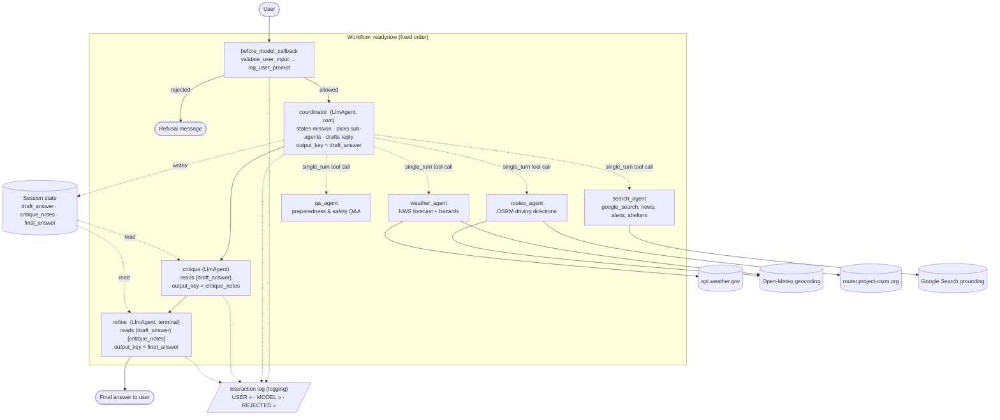

# ReadyNow! — Architecture

## Request flow

1. **Validate:** two Gemini classifiers on the raw message: malicious? off-mission? Either → refusal, no sub-agent runs. Fail open on classifier error.
2. **Coordinate:** root `LlmAgent` states capabilities or calls the sub-agent(s) needed; writes a combined draft to state.
3. **Critique:** reviews the draft for urgency ordering, clarity, missing safety steps.
4. **Refine:** rewrites using the critique. Terminal node, so its reply is what the user receives.

Stages hand off through session state: each writes its reply under its `output_key`; the next stage reads it via `{placeholder}` in its instruction. Every stage logs its output; the coordinator also logs the user prompt and any rejection.

## Components

| Agent           | Type          | Role                                                                |
| --------------- | ------------- | ------------------------------------------------------------------- |
| `readynow`      | `Workflow`    | Runs coordinator > critique > refine.                               |
| `coordinator`   | `LlmAgent`    | Mission, delegation, draft. Carries validation + logging callbacks. |
| `weather_agent` | `single_turn` | NWS forecast and hazards for a US place.                            |
| `search_agent`  | `single_turn` | News, alerts, shelters via Google Search.                           |
| `routes_agent`  | `single_turn` | Driving directions between two US places via OSRM.                  |
| `qa_agent`      | `single_turn` | Preparedness and safety guidance.                                   |
| `critique`      | `LlmAgent`    | Reviews the draft.                                                  |
| `refine`        | `LlmAgent`    | Final user-facing reply.                                            |

Deployed to Vertex AI Agent Engine by `deploy.py`; optional Model Armor screening via `MODEL_ARMOR_TEMPLATE`.
